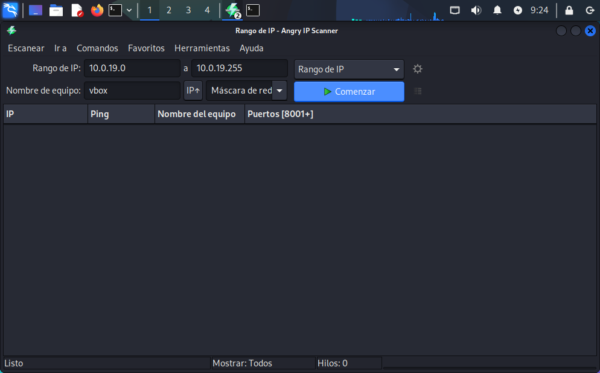
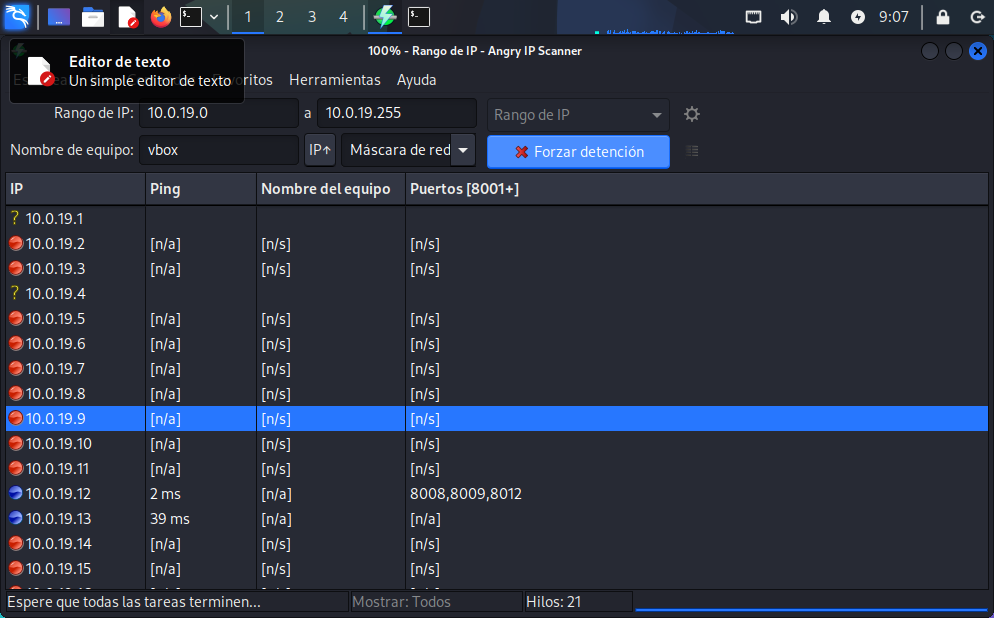
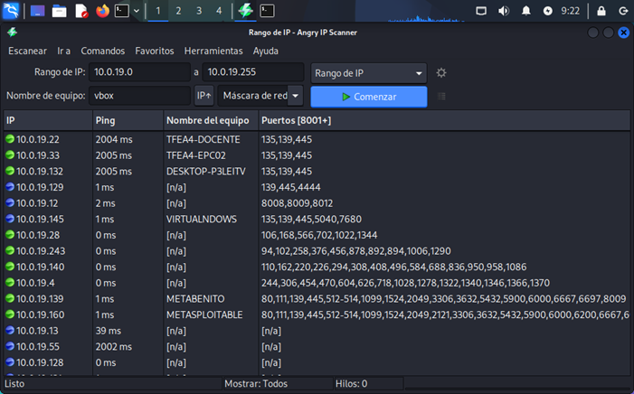

**Escaneo de equipos y puertos**

Los puertos, junto con las direcciones IP, permiten que los sistemas
operativos dirijan los flujos de datos a las aplicaciones correctas.
Cada puerto abierto representa un posible punto de entrada para los
ciberdelincuentes si la aplicación asociada tiene vulnerabilidades. Aquí
es donde el escaneo de puertos juega un papel fundamental, ayudando a
identificar vulnerabilidades que pueden ser explotadas.

El escaneo de puertos es un proceso automatizado que envía paquetes de
datos a un rango de **direcciones IP** o a un único host, con el
objetivo de identificar qué puertos están abiertos, cerrados o
filtrados. Al conocer los puertos abiertos los administradores de
sistemas pueden identificar vulnerabilidades de seguridad, realizar
auditorías de seguridad y diagnósticos de problemas de red.

**Métodos de escaneo**

- **TCP SYN**

  - identificar puertos abiertos sin establecer una conexión completa,
    reduciendo la visibilidad del escaneo en las aplicaciones
    monitoreadas, muy útil para el hacking ético y análisis de
    vulnerabilidades.

- **TCP Connect**

  - realiza una conexión completa a cada puerto, generando registros
    visibles en el sistema objetivo. útil cuando los privilegios del
    usuario son limitados.

- **TCP FIN, Xmas y Null**

  - aprovechan especificaciones del modelo OSI para diferenciar entre
    puertos abiertos y cerrados, siendo más discretos que otros métodos.
    Sin embargo, son menos efectivos en algunos sistemas, especialmente
    en entornos Windows.

- **UDP**

  - es más complejo debido a la naturaleza sin conexión del protocolo
    UDP. Es ideal para identificar servicios que utilizan este
    protocolo, aunque puede ser más lento y menos confiable que los
    escaneos TCP.

**Herramientas Populares**

- Netcat, versátil para comunicaciones seguras y escaneo de puertos.

- **Nmap,** esencial para realizar auditorías de seguridad, análisis de
  vulnerabilidades, y diagnósticos de red, compatible con firewalls,
  IPS, y IDS.

**Casos de Uso**

- Auditoría de Seguridad, permitiendo identificar puertos abiertos y
  servicios asociados para cerrar aquellos innecesarios y reducir la
  superficie de ataque.

- Diagnóstico de Problemas de Red, Si un servicio no está disponible, un
  escaneo de puertos puede ayudar a identificar si el puerto
  correspondiente está bloqueado por un firewall o un sistema de
  detección de intrusiones (IDS).

- Cumplimiento Normativo, El escaneo regular de puertos es requerido por
  muchas normativas, como PCI DSS, para garantizar que no haya puertos
  abiertos innecesarios que puedan ser explotados por atacantes.

**Mejores prácticas para realizar un escaneo de puertos**

- **Obtener autorización**: Siempre debes obtener el permiso explícito
  del propietario o administrador del sistema o red que deseas escanear.

- **Comunicar tus intenciones**: Informa al propietario o administrador
  del sistema o red que vas a realizar un escaneo de puertos y explica
  los motivos.

- **Limitar el alcance del escaneo**: Escanea solo los sistemas o redes
  para los que tienes autorización y no realices escaneos masivos o
  indiscriminados.

- **Utilizar herramientas de escaneo de puertos responsables**: Elige
  herramientas de escaneo de puertos que respeten la privacidad y no
  generen tráfico excesivo que pueda afectar el rendimiento de los
  sistemas o redes.

- **No escanear sistemas o redes sensibles**: Evita escanear sistemas o
  redes que contengan información confidencial o que sean críticas para
  la operación de una organización.

- **Respetar las leyes y regulaciones**: Asegúrate de cumplir con las
  leyes y regulaciones locales, nacionales e internacionales
  relacionadas con el escaneo de puertos.

**Angry IP Scanner**

**Abrimos el terminal verificamos nuestra IP y ejecutamos el comando
“IPSCAN”**

**Se iniciará el programa y debemos colocarles el rango de IPs que
queremos escanear**

**Iniciar el proceso y esperar a que termine**

**Al finalizar podremos ver todas las IPs con los puerto que se
encontraron abiertos.**

