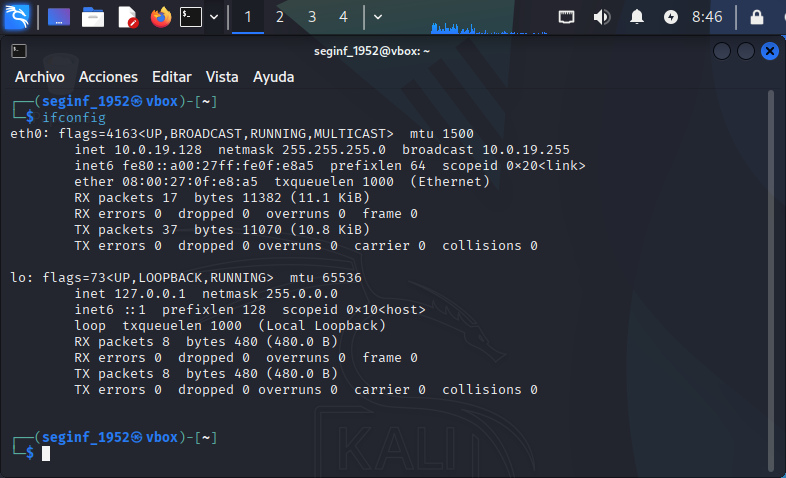

# Uso de Angry IP Scanner

**Abrimos el terminal verificamos nuestra IP y ejecutamos el comando
“IPSCAN”**

**Se iniciará el programa y debemos colocarles el rango de IPs que
queremos escanear**

**Iniciar el proceso y esperar a que termine**

**Al finalizar podremos ver todas las IPs con los puerto que se
encontraron abiertos.**

